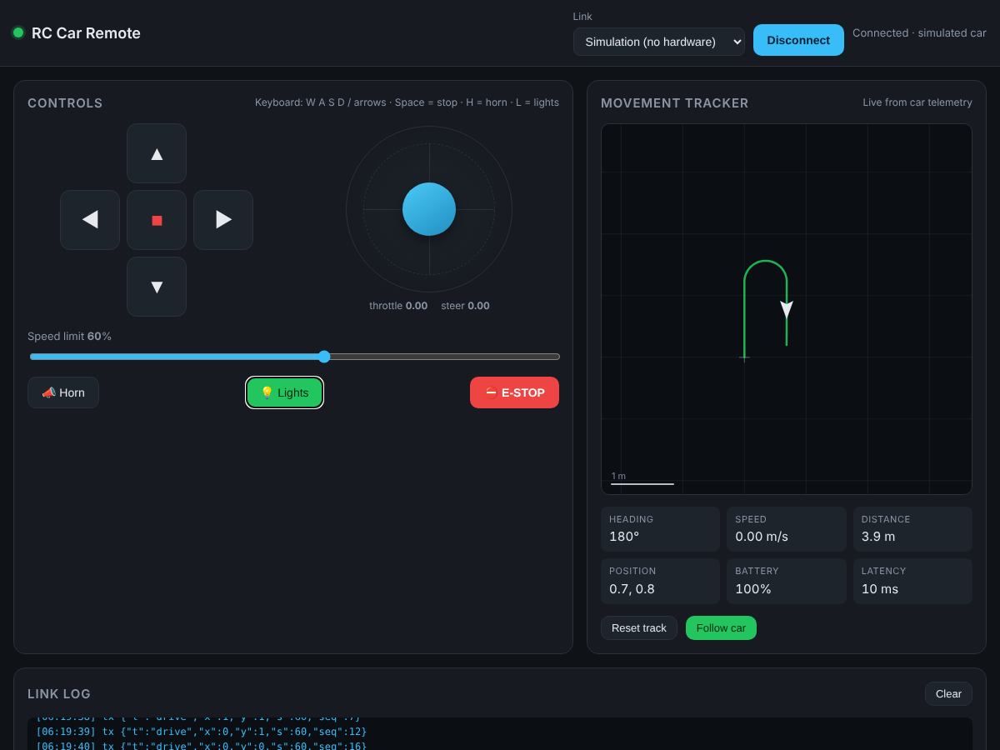

# RC Car Remote

A browser-based remote control for a toy RC car, with a mini movement tracker panel.
Plain HTML/CSS/JS, no build step, works on desktop and phone.



## Features

- **Controls**: on-screen D-pad, virtual joystick (touch/mouse), keyboard (`W A S D` / arrows,
  `Space` = stop, `H` = horn, `L` = lights), speed limiter, horn, lights, E-STOP.
- **Movement tracker**: top-down map showing the car's path, heading, speed, distance and
  position. Uses live telemetry from the car when it sends any; otherwise dead-reckons the
  path from the commands you send. Follow-car or fit-whole-path view, 1 m grid.
- **Link panel**: Wi-Fi (WebSocket), Bluetooth (Web Bluetooth), USB (Web Serial), or a
  built-in **Simulation** mode so you can try everything with no hardware.
- **Safety**: drive commands are re-sent every 250 ms while moving so the car can stop itself
  if the link drops (the reference firmware does this after 500 ms of silence).

## Run it

```sh
python3 -m http.server 8080      # or any static file server
# open http://localhost:8080
```

Pick **Simulation** and press **Connect** to try it without a car.

> Web Bluetooth and Web Serial only work in Chromium browsers (Chrome, Edge) and only from
> `https://` or `http://localhost`. WebSocket works everywhere, including from a phone.

## What you need to connect to a real car

The browser cannot drive motors directly. The car needs a small controller board that
speaks one of the three links. Pick one:

| Link | Car side | Good for |
|------|----------|----------|
| **Wi-Fi / WebSocket** (recommended) | ESP32 or ESP8266 running `firmware/esp32_ws_car`, or a Raspberry Pi running any WebSocket server | Phone or laptop, no pairing, longest range |
| **Bluetooth / Web Bluetooth** | ESP32 / nRF52 / HM-10 exposing a Nordic UART Service (NUS) | Phone control without a Wi-Fi network |
| **USB / Web Serial** | Arduino / ESP32 over a USB cable at 115200 baud | Bench testing, tethered cars |

Hardware shopping list for the reference build:

1. **ESP32 dev board** (any; the sketch uses the Arduino core).
2. **Dual H-bridge motor driver** such as L298N or TB6612FNG, wired to the drive motor(s).
   For a steering servo instead of a second motor, drive the servo from `cmdX` in the sketch.
3. **Battery** for the motors (the ESP32 can share it through its 5 V regulator), optional
   voltage divider on an ADC pin for the battery readout.
4. Optional **buzzer** (horn) and **LEDs** (lights).

Flash `firmware/esp32_ws_car/esp32_ws_car.ino`, join the Wi-Fi network `RC-Car`
(password `drive1234`) from your phone or laptop, open the web app, choose
**Wi-Fi · WebSocket** with `ws://192.168.4.1:81`, and press Connect.

## Protocol

Newline-delimited JSON in both directions. Any controller that speaks this works with the app.

| Direction | Message | Meaning |
|-----------|---------|---------|
| → car | `{"t":"drive","x":-1..1,"y":-1..1,"s":0..100,"seq":n}` | steer, throttle, speed limit |
| → car | `{"t":"stop"}` | stop now |
| → car | `{"t":"horn"}` / `{"t":"lights","on":true}` | accessories |
| → car | `{"t":"ping","ts":ms}` | latency probe |
| car → | `{"t":"pong","ts":ms}` | reply to ping |
| car → | `{"t":"tel","x":m,"y":m,"h":deg,"v":m/s,"batt":%}` | optional telemetry; any subset of fields |

If your car has wheel encoders, a GPS, or an IMU, put real values in the `tel` message and
the tracker switches from "Estimated from commands" to "Live from car telemetry".

## Files

```
index.html                       UI
css/style.css                    styling (dark, responsive)
js/app.js                        input handling, 20 Hz control loop, render loop
js/transport.js                  WebSocket / Bluetooth / Serial / Simulation links
js/tracker.js                    movement tracker (path, dead reckoning, canvas)
firmware/esp32_ws_car/           reference ESP32 firmware
```
